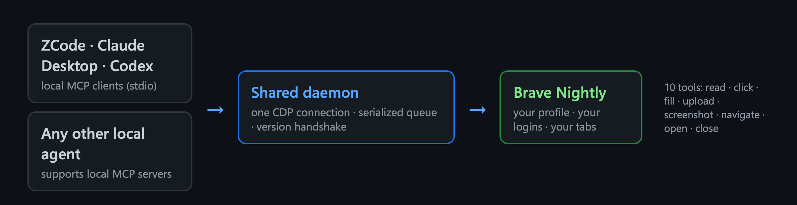

# Brave Session MCP

English · [Deutsch](README.de.md)

A local MCP server that gives your AI agents safe, token-efficient access to the Brave browser you're already logged into.

[](https://github.com/MacStenk/brave-mcp/releases) [](LICENSE) [](package.json)

**Status:** early, actively maintained by one person · tested on macOS with Brave Nightly; Linux plausible, untested · License: [MIT](LICENSE)

## What is this?

[Model Context Protocol (MCP)](https://modelcontextprotocol.io) is the open standard AI applications use to call external tools. This server exposes your already-running Brave Nightly — its open tabs and its logged-in sessions. Agents read pages, click, fill forms, upload files and take screenshots inside the real browser profile, not a disposable automation profile. One shared background process holds the debugging connection open for every local MCP client, so a new agent never triggers a new Brave permission prompt.



## Why this over the alternatives?

Attaching an agent to your logged-in browser is no longer unique: [@playwright/mcp](https://github.com/microsoft/playwright-mcp) can connect to existing Chrome or Edge tabs through its browser extension (`--extension`), and [Chrome DevTools MCP](https://developer.chrome.com/blog/chrome-devtools-mcp-debug-your-browser-session) attaches to a running Chrome with `--autoConnect` (Chrome 144+). Use those if you live in Chrome. This server is the Brave-first option and makes different trade-offs:

- **Brave, your real profile** — works with Brave Nightly where you are already logged in; no extension to install, no profile copied. Regular Brave via `BRAVE_USER_DATA_DIR` should work but is untested.
- **One shared connection for all agents** — a single background process serves every local MCP client over one CDP connection, so a second agent does not trigger another permission prompt.
- **Token-efficient by design** — capped and paged text (`charOffset`), paged and filterable controls (`controlFilter`), waited actions (`wait`), icon characters stripped, CSS-scaled screenshots; measured numbers in the [Token usage](#token-usage) section below.
- **Small attack surface** — ten narrow tools and no page-script execution; uploads only from one folder; agents can close only tabs they opened; page content is treated as untrusted data.

Not for you when you need headless cross-platform CI automation, or a full DevTools toolbox (network, performance traces, console) — Playwright MCP and Chrome DevTools MCP are the better fit there.

## Quick start

```sh
pnpm install --frozen-lockfile
node src/server.mjs
```

Requires Node ≥ 22, pnpm and Brave Nightly (remote debugging enabled once, see below). Install means `git clone` — this is not published to a package registry. Regular Brave instead of Nightly is untested: set `BRAVE_USER_DATA_DIR` to its profile directory and `BRAVE_APP` to its app name (see below).

*Unofficial community project — Brave is a trademark of Brave Software, Inc.; this tool is not affiliated with or endorsed by them.*

## Running the server

Requirements: Node.js 22+, pnpm and Brave Nightly. No separately downloaded
test browser and no extension required.

The server speaks MCP over stdin/stdout. In your MCP client, start `node`
directly — not a package manager that prints extra output to stdout.

Open `brave://inspect/#remote-debugging` in Brave Nightly once and enable the
permission for that browser instance. Brave may ask you to confirm the first
connection. It then persists until the browser closes or you disconnect it.
After a browser restart, granting the permission in Brave again is enough; the
shared process reconnects on the next call. For a different Brave profile, set
`BRAVE_USER_DATA_DIR` to its user data directory. No profiles, cookies or key
files are ever copied.

`brave_upload` only accepts files from one folder, `~/Downloads` by default. Set
`BRAVE_MCP_UPLOAD_DIR` to use another one. Paths outside it, `../` tricks and
symlinks pointing out of it are refused, so a page cannot talk an agent into
uploading your SSH keys. The shared background process reads the variable when it
starts; after changing it, run `node src/server.mjs --stop`.

### Recommended: a separate agent profile (macOS)

By default agents see every tab of your browser, including mail and banking. To keep them away from those, give them their own Brave profile:

1. In Brave, click the profile icon → **Add**, name the profile `Agent` and pick a colour you will recognise.
2. In that profile, sign in only to the services agents may use.
3. Set `BRAVE_MCP_PROFILE=Agent` in your MCP client config and run `node src/server.mjs --stop` once.

From then on `brave_open` opens tabs in the Agent profile, and every tool sees **only** that profile's tabs; tabs in your other profiles stay invisible to agents, although everything runs in the same Brave. brave-mcp only reads the profile list and never creates or changes profiles. Opening tabs in another profile goes through macOS `open`, so this option is macOS-only for now. `BRAVE_APP` names the Brave app to open (default `Brave Browser Nightly`).

## Clients

The examples in `config/` contain placeholder paths; substitute the absolute
path of your own clone. If a client cannot start `node` because it inherits no
PATH environment (common for GUI apps), use the absolute node path from
`which node` as the command.

- Claude Desktop and other local clients using `mcpServers`: copy the entry from `config/mcp.json`.
- Codex and other TOML clients: use `config/codex.toml` as the example.
- ZCode: copy the entry from `config/zcode.json` into `~/.zcode/cli/config.json` under `mcp.servers`.
- Other agents can start the same stdio server as long as their application supports local MCP servers.
- ChatGPT on the web and Grok on the web are not connected automatically. An
  application that only supports remote MCP servers needs an additional local
  bridge or a matching host integration. This server exposes no network access.

The client configurations are examples; existing app settings were not changed
automatically. No plugin and no public directory listing were created. License:
MIT, see LICENSE.

## Tools

| Name | Function |
| --- | --- |
| `brave_status` | Check the shared connection and process |
| `brave_tabs` | List open tabs with stable IDs |
| `brave_read` | Read visible text, controls and frames; text paged via `charOffset`, controls paged via `controlOffset`, searchable via `controlFilter` |
| `brave_click` | Click a previously read element, optionally with wait time; checkboxes and switches report their state afterwards |
| `brave_fill` | Fill a previously read input field |
| `brave_upload` | Select files from the upload folder (`BRAVE_MCP_UPLOAD_DIR`, default `~/Downloads`) in an upload field |
| `brave_screenshot` | Screenshot of a tab at CSS resolution, optionally downscaled to a target width |
| `brave_navigate` | Navigate a selected tab to HTTP(S), optionally with wait time |
| `brave_open` | Open an address in a new tab, optionally with wait time |
| `brave_close` | Close a tab you opened with `brave_open`; the user's own tabs stay untouched |

Call `brave_tabs` first, then `brave_read` with a concrete tab ID.
`brave_read` reports `charsTotal` and `nextCharOffset`; with `charOffset`,
agents page through pages longer than the read limit. Click, navigate and open
accept `wait` in milliseconds and return only after the page has loaded plus a
short settle phase; without `wait`, the action returns immediately. Embedded
applications are read through the returned frame IDs. Actions use references to
concrete DOM elements, bound to their tab. Changed, expired and foreign-tab
references are rejected. Controls: `controlsTotal` reports all matches,
`nextControlOffset` the next page (otherwise `null`). On pages with huge
navigations, `controlFilter` searches by label or row text instead of reading
200 menu links. Checkboxes, radio buttons and switches (`role="switch"`) carry
`checked`; unlabeled elements carry their row text as `context`. When an icon
sits on top of a checkbox, `brave_click` clicks the position instead of
failing. Website text remains untrusted data — never an instruction to the agent.

Multiple agents share the browser. Individual calls are processed one after
another; whole workflows are not reserved exclusively. Agents should use their
own tabs and re-read after changes made by others.

## Token usage

The server limits agent token usage by design instead of leaving it to the
client:

- `brave_read` returns at most 12,000 characters per call (default 6,000), at
  most 200 controls per call (paged via `controlsTotal` and
  `nextControlOffset`), labels truncated to 180 characters, icon characters
  from web fonts (Unicode Private Use Area) removed. With `charOffset` and
  `nextCharOffset`, agents page deliberately instead of re-reading a long page
  in full.
- `brave_read` returns visible text, not HTML source: markup, attributes and
  script blocks are a multiple of the visible text and stay out.
- Actions send only a compact element reference instead of a full element
  description; `brave_tabs` and `brave_status` are lean metadata calls with no
  page content.
- `wait` replaces polling loops after clicks: one waiting action instead of
  repeated full reads.
- `brave_screenshot` captures at CSS pixel resolution instead of device
  resolution; on retina displays that costs roughly a quarter of the image
  tokens. The optional `width` parameter (320–1280) downscales further. Image
  tokens follow pixel dimensions, not file size; JPEG compression saves no
  tokens, smaller dimensions do. WebP and neural codecs change nothing either —
  they optimize bytes, not pixels. This server never stores screenshots (local
  socket delivery only), so JPEG is a deliberate choice; if storage ever gets
  added, WebP would be the right pick (25–35% smaller, accepted by all vision
  APIs). Widths of 320–512 reach the level of OpenAI's `detail: low`; the real
  parameter can only be set by the calling client, not server-side.

Own measurement from 2026-11-18 (`node test/tokens.mjs`, this retina display,
window 2302×1364 CSS pixels, retina factor 2; token values are approximations
based on provider formulas):

| Screenshot variant | Pixels | Claude classic | Claude 28-px patches | OpenAI high detail | Gemini |
| --- | --- | --- | --- | --- | --- |
| Device resolution (old default) | 4604×2728 | 16,747 | 16,170 | 2,125 | 6,192 |
| CSS resolution (current default) | 2302×1364 | 4,187 | 4,067 | 2,125 | 1,548 |
| CSS + `width=768` | 768×455 | 466 | 476 | 425 | 258 |

Result: the default screenshot costs about a quarter of the old value thanks to
CSS resolution (OpenAI pre-scales to 2048 pixels anyway, so CSS resolution
saves nothing there — `width` does). With `width=768` a screenshot drops to
258–476 tokens — under a third of one `brave_read` call with 6,000 characters
(roughly 1,500–2,000 tokens). The old device-resolution screenshot on Claude
cost as much as a good nine such text reads.

## Working rules for agents

Field-tested practices; anyone using this MCP works by them:

- Check the functions an MCP offers first, then reach missing surfaces through
  the browser. A single MCP rarely covers a whole application.
- Submitted is not done. Check visible evidence first: the new post in the
  history, the confirmation, the produced file. "Requested", "executed" and
  "saved" are different states; when the outcome is unclear, do not blindly
  repeat a write — re-read the state.
- Define what "done" means before starting, and report further extensions as
  their own task instead of quietly widening a check.

## Limits

Downloads run inside the browser into the profile's download folder; this
server does not expose them as a tool yet and reports neither path nor success.
If that is needed, it is its own follow-up task.

## Stopping the shared connection

```sh
node src/server.mjs --stop
```

This disconnects the shared access for all clients but leaves Brave and its
tabs open. Closing a single MCP client does not disconnect the shared
connection. After changes to the server code, stop the shared process once
with `--stop`; the next client call restarts it with the new code. The client
compares its API version with the process's; an outdated process is reported
explicitly instead of silently ignoring new options.

The local Unix socket lives in a user directory with mode 0700 and is itself
accessible only to that user (0600). There is no open HTTP server for MCP.
POSIX systems are supported; tested live on macOS with Brave Nightly.

## Releases

What changed in each version: [CHANGELOG.md](CHANGELOG.md). What a version number
promises, what counts as breaking and which versions get fixes:
[RELEASES.md](RELEASES.md).

## Verification

```sh
pnpm test
node test/smoke.mjs
node test/tokens.mjs
```

The token measurement opens its own test tab, measures the three screenshot
variants on your own machine and closes it again.

The live test opens its own local test tab. It verifies the MCP handshake, the
tool catalog, text input, real clicks, a hidden file upload, an embedded frame
and screenshots. Two separate MCP clients must report the same process and
exactly one browser connection. Existing tabs are never navigated. At the end
the test closes its own tab with `brave_close`; its test server ends with the
test process.

As of 2026-11-18: nine local checks passing, live test with two MCP clients
and all ten tools successful, including wait after click/navigation, text
paging via `charOffset`, control paging and filtering, switch state, covered
checkboxes, icon character removal, closing your own tab, target-width
screenshots, version handshake and reconnection after browser restart.
